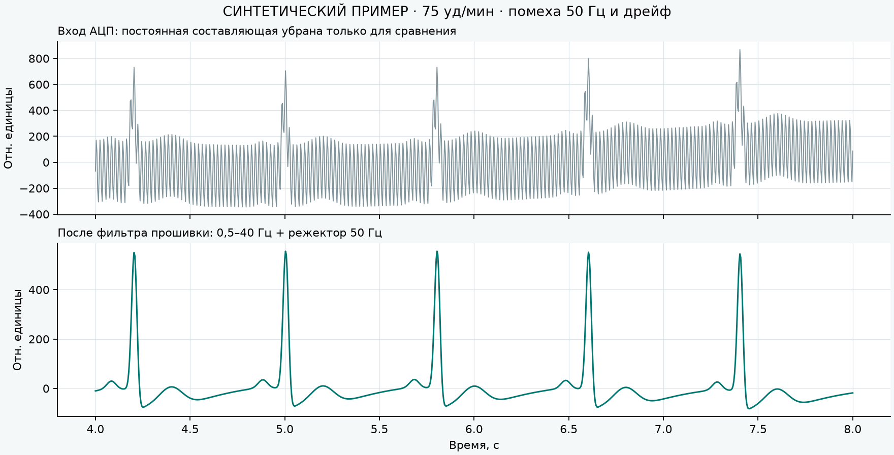

# Cardio Monitor — ESP32-C3 Super Mini

Прошивка для ESP32-C3 Super Mini с 4 МБ flash, ILI9341 320×240,
MAX30102, AD8232 через ADS1115 и четырьмя TTP223. Основной файл —
[MedicalMonitor/MedicalMonitor.ino](MedicalMonitor/MedicalMonitor.ino).
Папка `MedicalMonitor/Pulse+SpO2/` содержит используемый библиотечный
RF-алгоритм, а не отдельную прошивку. Общая карта репозитория, включая Android,
находится в [корневом README](../README.md).

## Карта файлов прошивки

Все пути в таблицах ниже указаны относительно `Monitor soft/`. Исходный скетч
находится в `MedicalMonitor/`: его нужно редактировать, сохранять в Git и открывать
непосредственно в Arduino IDE. Файлы в `build/` — создаваемые копии и результаты
сборки; они не обязательны для работы в IDE. Прошивка написана на C++, включая `.ino`;
Python-инструменты ниже запускаются только на компьютере.

### Основной код

| Файл | За что отвечает |
|---|---|
| [MedicalMonitor/MedicalMonitor.ino](MedicalMonitor/MedicalMonitor.ino) | Точка входа `setup()` / `loop()`, распиновка, палитра, основные переводы, экраны и кнопки. Инициализирует SPI/I2C, запускает задачу датчиков, принимает её сообщения и передаёт отсчёты обработчикам. Здесь же находятся Wi-Fi, сохранение настроек NVS, буферизация CSV на SD, просмотр истории и отрисовка результатов анализа. |
| [MedicalMonitor/Acquisition.h](MedicalMonitor/Acquisition.h) | Задача FreeRTOS `acquisitionTask()`: единоличный доступ к I2C после запуска, расписание ADS1115 A0/A1/A2, чтение MAX30102 FIFO, применение токов LED и проверка регистров. Создаёт сообщения `SensorSample` и состояние `SensorHealth`, учитывает потери, ошибки и поколения сессии/оптических настроек. Не рисует экран и не пишет на SD. |
| [MedicalMonitor/SignalProcessing.h](MedicalMonitor/SignalProcessing.h) | `PulseOxProcessor`: окно RED/IR, контроль наличия пальца, насыщения, временных разрывов, запуск RF-расчёта и проверка готовности результатов. Также `DebouncedButton` для кнопок и приблизительная оценка процента батареи `estimateBatteryPercent()`. |
| [MedicalMonitor/DisplayModel.h](MedicalMonitor/DisplayModel.h) | Фиксированный накопитель min/среднее/max принятых значений ЧСС для текущего сеанса, без хранения массива истории. |
| [MedicalMonitor/EcgProcessing.h](MedicalMonitor/EcgProcessing.h) | Фильтры `EcgBiquad` / `EcgFilter`, интерполяция по меткам времени и предварительный детектор ЧСС `EcgBeatDetector`. Сравнение ЭКГ/оптической ЧСС `compareHeartRates()` и ограниченный буфер экстремумов для графика `EcgPlotBuffer`. Не определяет медицинский диагноз. |
| [MedicalMonitor/PpgAutoExposure.h](MedicalMonitor/PpgAutoExposure.h) | Независимый от Arduino контроллер `ppg::AutoExposure`: накапливает статистику RED/IR, выбирает ограниченные изменения токов, состояние поиска/настройки/качества и выдержки. Сам регистры не пишет: решение применяет `Acquisition.h`. |
| [MedicalMonitor/HistoryAnalysis.h](MedicalMonitor/HistoryAnalysis.h) | `cardio::HistoryCsvStream` разбирает CSV небольшими порциями; `HistoryAnalysis` и `MetricSummary` накапливают длительности, качество, статистику и эпизоды отклонений. Учитывают повреждённые строки, пропуски, смену настроек и неподдерживаемые форматы. Нет загрузки целого файла и анализа формы комплексов ЭКГ. |
| [MedicalMonitor/HistoryText.h](MedicalMonitor/HistoryText.h) | Таблица `history_text::words` с названиями, пояснениями и советами вкладок «Сводка», «Анализ», «Помощь» на EN/RU/KZ. Числовые правила находятся в `HistoryAnalysis.h`, выбор и отрисовка текста — в `.ino`. |
| [MedicalMonitor/rf_algorithm.cpp](MedicalMonitor/rf_algorithm.cpp) | Небольшая единица компиляции, которая подключает реализацию RF из вложенной папки. Нужна, чтобы Arduino собрал этот алгоритм вместе с основным скетчем. Не добавляйте вторую копию `algorithm_by_RF.cpp` в корень скетча: это может вызвать повторное определение функций. |

### RF-алгоритм и его происхождение

Сокращённая папка `MedicalMonitor/Pulse+SpO2/MAX30102_by_RF-master/` содержит только используемые
файлы. Старые самостоятельный скетч, альтернативный алгоритм Maxim, драйвер,
настройки и демонстрационные CSV/PNG удалены: основная прошивка их не вызывает.

| Файл | За что отвечает |
|---|---|
| [algorithm_by_RF.h](MedicalMonitor/Pulse+SpO2/MAX30102_by_RF-master/algorithm_by_RF.h) | Интерфейс RF, частота `FS`, длина окна `ST`, пределы ЧСС, пороги корреляции и производные константы. Содержит авторское уведомление и лицензию. |
| [algorithm_by_RF.cpp](MedicalMonitor/Pulse+SpO2/MAX30102_by_RF-master/algorithm_by_RF.cpp) | Удаление среднего и линейного тренда, корреляция RED/IR, поиск периода по автокорреляции и эмпирическая формула SpO₂. Локальные проверки входов и `rf_reset_state()` не заменяют калибровку оптики. Авторское уведомление и лицензию сохранять. |
| [README.md RF](MedicalMonitor/Pulse+SpO2/MAX30102_by_RF-master/README.md) | Происхождение стороннего кода, состав оставленных файлов, изменения интеграции и условия сохранения авторства. |

### Инструменты, тесты и документация

| Файл | За что отвечает |
|---|---|
| [tools/build.py](tools/build.py) | Необязательный инструмент командной строки: копирует исходники из `MedicalMonitor/` в `build/MedicalMonitor/` и вызывает Arduino CLI для ESP32-C3; `--stage-only` только создаёт копию, `--upload PORT` дополнительно прошивает плату. В Arduino IDE исходный скетч открывается без этого инструмента. |
| [tools/preview_display.py](tools/preview_display.py) | Извлекает функции рисования из скетча, компилирует их с SVG-адаптером и создаёт четыре превью на синтетических данных. Нужен C++17-компилятор; шрифт и заголовок приблизительные. |
| [tools/plot_ecg.py](tools/plot_ecg.py) | Строит PNG-график ЭКГ из CSV на компьютере. Режим `--demo` генерирует синтетический сигнал и пропускает его через тот же C++-фильтр. Не запускается на ESP32 или SD. |
| [tests/run.py](tests/run.py) | Собирает и запускает шесть нативных C++-наборов тестов с AddressSanitizer и UndefinedBehaviorSanitizer; создаёт временные заглушки FreeRTOS, плата не нужна. |
| [tests/display_tests.cpp](tests/display_tests.cpp) | Пустая/невалидная статистика, накопление, округление и сброс сеанса интерфейса. |
| [tests/signal_tests.cpp](tests/signal_tests.cpp) | Проверки RF и `PulseOxProcessor`: синтетический сигнал, плохие/вырожденные входы, сброс и устаревание; также кнопки и оценка батареи. |
| [tests/acquisition_tests.cpp](tests/acquisition_tests.cpp) | Проверяет настоящую задачу сбора через имитацию Wire/датчиков/FreeRTOS: расписание каналов, FIFO, ошибки и восстановление, смену LED и временные выдержки. Это имитация, не измерение времени на ESP32. |
| [tests/ecg_tests.cpp](tests/ecg_tests.cpp) | Проверки частотного отклика фильтра, детектора ЧСС на синтетике, временных разрывов/джиттера, графического буфера и сравнения ЧСС. |
| [tests/history_analysis_tests.cpp](tests/history_analysis_tests.cpp) | Форматы CSV, потоковое чтение, валидность, взвешенная статистика, длительности отклонений и поведение при коротких/повреждённых/неполных записях. |
| [tests/ppg_auto_tests.cpp](tests/ppg_auto_tests.cpp) | Контроллер автонастройки: пределы и шаги токов, насыщение, отсутствие пальца, нестабильность, выдержки и восстановление. |
| [docs/history-analysis-medical-notes.md](docs/history-analysis-medical-notes.md) | Источники для пользовательских пояснений, границы анализа истории и перечень необходимых медицинских/аппаратных проверок. |
| [docs/ecg-filter-demo.png](docs/ecg-filter-demo.png) | Иллюстрация синтетического примера фильтра из `plot_ecg.py --demo`; не запись пациента и не доказательство клинической точности. |
| [README.md](README.md) | Эта инструкция: файлы, распиновка, функции, сборка, SD, ограничения и проверка устройства. |

Корневой [`.gitignore`](../.gitignore) исключает сборки, кэши и личные измерения.
[GitHub Actions](../.github/workflows/firmware-tests.yml) запускает нативные тесты;
успех этого задания не означает, что проверено реальное оборудование.

## Как связаны модули

```text
AD8232 → ADS1115 A0 ─┐
Батарея → ADS A1 ────┤
Назад → ADS A2 ──────┼→ Acquisition.h → sampleQueue / healthQueue
MAX30102 RED/IR ─────┘        ↕                     ↓
                      PpgAutoExposure.h    MedicalMonitor.ino
                                             consumeSamples()
                                                  ↓
                         ┌────────────────────────┴─────────────────┐
                         ↓                                          ↓
                 EcgProcessing.h                     SignalProcessing.h → RF
                         └────────────────────────┬─────────────────┘
                                                  ↓
                               графики и числа + буфер CSV → microSD
                                                                   ↓
                      HistoryAnalysis.h ← чтение файла небольшими порциями
                               ↓
                  HistoryText.h + отрисовка в .ino → экран истории
```

После `setup()` I2C обслуживает только `acquisitionTask()`. Основной `loop()`
забирает сообщения из фиксированных очередей, рассчитывает показатели, обслуживает
кнопки, экран, SD и Wi-Fi. Задача датчиков и основной цикл исполняются планировщиком
на одном ядре ESP32-C3: отдельная задача не означает отдельное физическое ядро и
не гарантирует отсутствие задержек. Переполнение очереди фиксируется в диагностике.

Команда с поколением сессии не позволяет использовать остатки предыдущего измерения;
поколение оптических настроек не позволяет смешать разные токи LED в RF-окне.
Сбросы, ошибки и старые данные снимают валидность результата. Значок хорошего сигнала
показывает прохождение программных проверок, а не установленную медицинскую точность.

В режимах ЭКГ и Пульс работают A0 АЦП и оптический канал; экран Пульс показывает
настоящую мини-ЭКГ. В режиме SpO₂ АЦП обслуживает батарею и кнопку Назад. Анализ истории вычисляется из сохранённого CSV;
готовые заключения не накапливаются во внутренней flash. Экран и SD разделяют SPI,
поэтому их операции выполняются в основном цикле с отдельными CS.

## Где менять конкретное поведение

Файлы прошивки в этой таблице находятся внутри `MedicalMonitor/`; пути к инструментам
и тестам указаны относительно `Monitor soft/`.

| Задача | Где редактировать и что учитывать |
|---|---|
| Изменить распиновку | Блок конфигурации в `MedicalMonitor.ino`: `TFT_*`, `SPI_*`, `SD_CS_PIN`, `I2C_*`, `ADS_CH_*`, `BTN_*`. Обновить таблицу подключения в README. |
| Изменить дизайн или расположение | `COL_*`, размеры экрана и функции `draw*` / `render*` в `.ino`. Цвет и масштаб изображения сами по себе не меняют алгоритм измерения. |
| Изменить надписи и переводы | Основные строки `STR_EN` / `STR_RU` / `STR_KZ` и `StringID` в `.ino`; подробные тексты истории в `HistoryText.h`. Порядок языков EN/RU/KZ должен совпадать. |
| Изменить переходы и кнопки | `ScreenID`, `onUp()`, `onDown()`, `onOk()`, `onBack()` в `.ino`; антидребезг/повтор — `DebouncedButton` в `SignalProcessing.h`. |
| Настроить расписание датчиков | `acquisitionTask()` в `Acquisition.h`. После запуска не добавлять чтения Wire в функции UI: для новых данных использовать сообщения/состояние задачи. |
| Изменить автонастройку LED | `PpgAutoExposure.h`; запись регистров и сброс FIFO — `configurePpgLeds()` / `applyExposure` в `Acquisition.h`. Проверять `ppg_auto_tests.cpp` и `acquisition_tests.cpp`. |
| Изменить качество/расчёт PPG | `PulseOxProcessor` и RF `.h/.cpp`. Частота FIFO, реконструкция меток времени, `FS`, `ST`, константа `sum_X2`, размеры окна и таймауты взаимосвязаны: нельзя менять только один параметр. |
| Изменить фильтр/детектор ЭКГ | `EcgProcessing.h`; масштаб отрисовки и выбор 50/60/Выкл — `.ino`. Проверять `ecg_tests.cpp`, затем реальные данные/симулятор. |
| Изменить историю и анализ | Правила/накопители — `HistoryAnalysis.h`; формулировки — `HistoryText.h`; чтение, контекст взрослого в покое, вкладки и перенос текста — функции истории в `.ino`. Обновлять тесты и медицинские примечания вместе с правилами. |
| Изменить CSV или запись | `openLogFile()`, `consumeSamples()`, `appendLog()`, `flushLogBuffer()` в `.ino`. Согласовать новый формат с `HistoryAnalysis.h`, `plot_ecg.py` и тестами; старые записи не должны молча получать неверную интерпретацию. |
| Уточнить напряжение батареи | `BATTERY_DIVIDER_RATIO` в `.ino`, преобразование ADS в `Acquisition.h`, кривая процента в `SignalProcessing.h`; сначала сопоставить с мультиметром. |
| Добавить новый файл прошивки | Создать его в `MedicalMonitor/`; для сборки инструментом командной строки также обновить явный список копирования в `tools/build.py`. |
| Изменить сборку/проверки | `tools/build.py`, `tests/run.py`, корневой workflow; исходники тестов выбираются по затронутому модулю. |

Изменения в `build/MedicalMonitor/` исчезнут при следующей подготовке. Если правка
случайно сделана там, сначала перенесите её в соответствующий исходный файл
в `MedicalMonitor/`, а уже затем запускайте `build.py`.

## Светлый интерфейс и управление

Восстановлено первоначальное главное меню: ЭКГ, Пульс, SpO₂, История, Настройки.
Оно открывается при включении. Выбранный пункт подсвечен; после возврата выделение
сохраняется. Светлые экраны измерений и обработка сигналов сохранены.

| Физическая кнопка | Действие |
|---|---|
| 1, GPIO 1 | Вверх: предыдущий пункт / страница |
| 2, GPIO 2 | Вниз: следующий пункт / страница |
| 3, GPIO 10 | OK: открыть пункт / изменить настройку |
| 4, ADS1115 A2 | Назад: вернуться на один уровень |

Чтобы сменить измерение: **Назад → Вверх/Вниз → OK**. На экране измерения
кнопки 1/2/3 не переключают режим и не меняют запись; снизу показана подсказка
«4 НАЗАД: главное меню». Назад завершает сеанс и закрывает CSV.
Запись включается и выключается через **Настройки → Запись**; при включённой
записи открытие измерения создаёт новый файл. Индикатор REC означает открытый файл.

Пульс показывает крупную ЧСС, min/среднее/max принятых значений за сеанс и мини-ЭКГ.
SpO₂ показывает сатурацию, оптическую ЧСС, наличие пальца и PPG. ЭКГ показывает
один канал, предварительную ЧСС и качество сигнала. Статистика занимает фиксированный
объём RAM и сбрасывается при начале сеанса.

Настройки дополнены пунктами «Тема: Светлая», сеткой (мелкая+крупная / крупная),
информацией о фиксированной подсветке и развёртке 0,2 с/дел. Тема всегда светлая;
выбор сетки сохраняется в NVS, история остаётся на microSD. Яркость программно
не регулируется: BLK подключён непосредственно к 3,3 В.

Сетка ЭКГ декоративная, амплитуда относительная. Подписей 10 мм/мВ, отведения II
и импульса 1 мВ нет: тракт и расположение электродов ещё не откалиброваны.
При плохом сигнале — жёлтое предупреждение и отсутствие ЧСС. LO+/LO− не подключены,
поэтому сообщение «Проверьте сигнал ЭКГ» не выдаётся за точное обнаружение обрыва.
Часы RTC/NTP отсутствуют: история прибора сохраняет номера записей, не выдуманные даты.

[Примеры экранов и создание SVG-превью](docs/light-interface.md).

## Что работает в коде

- Светлый интерфейс с бирюзовыми акцентами; русский, английский и казахский языки.
- ЭКГ: поток A0, фильтры 0,5–40 Гц и режектор 50/60 Гц (можно отключить),
  график по времени измерений, предварительная оценка ЧСС. На экране одновременно
  отображается ЧСС по ЭКГ. Оптические показатели видны на вкладках Пульс и SpO₂;
  одновременный сбор сохраняется, сравнение частот используется в анализе истории.
- Пульс / SpO₂: синхронные пары RED/IR из FIFO, существующий RF-алгоритм,
  контроль корреляции и периодичности. Окно — 100 отсчётов / 4 секунды,
  обновление — каждые 25 отсчётов. После установления уровня сигнала для первых
  цифр нужны два принятых окна, около 5 секунд; автонастройка добавляет своё время.
- Автонастройка токов RED/IR MAX30102 с ограничением диапазона и шага,
  проверкой записи регистров, выдержкой после изменений и подсказками на экране.
- Сброс показаний при отсутствии пальца, насыщении, потере/старении данных и плохом сигнале.
  Невалидный результат отображается как `--`, а не как искусственно ограниченные 70–100%.
- Wi-Fi: поиск сетей 2,4 ГГц, клавиатура, сохранение подключения, отмена соединения,
  включение/выключение радио и удаление сохранённой сети с подтверждением.
- microSD: автоматическая запись при открытии измерения, CSV, просмотр истории,
  постраничный список и вкладки «Сводка», «Анализ», «Помощь» для выбранной записи.
  Анализ учитывает валидность, длительность, пропуски, min/среднее/max и участки
  отклонений частоты/SpO₂; формулировки и рекомендации доступны на трёх языках.
- Настройки записи, масштаба ЭКГ x1/x2/x4/x8 и диагностика датчиков, SD, батареи и RAM.
- Работа измерений без SD; ошибка карты останавливает запись и показывает `SD!`.
  После установки карты: Настройки → Состояние устройства → OK.
- Повторный поиск датчиков после ошибок I2C. Отказ ADS1115 не должен лишать возможности
  выйти из экрана: удерживайте Вверх + Вниз около 1,2 секунды.

Wi-Fi сейчас обеспечивает подключение к сети. Сервер передачи измерений и сопряжение
с `CardioMonitorApp` пока не реализованы; Android-приложение в соседней папке остаётся
отдельным прототипом. Само подключение к Wi-Fi не отправляет историю в приложение.

## Память и SD

Вычисления выполняет ESP32; SD — хранилище, она не исполняет код.
Прошивка, шрифты и несколько настроек остаются во flash ESP32. Записи измерений
не попадают ни в NVS, ни во внутреннюю файловую систему.

| Данные | Где хранятся |
|---|---|
| CSV ЭКГ, RED/IR, пульса, SpO₂ | Только microSD |
| Номера сессий | Восстанавливаются из имён на microSD при её подключении |
| Язык, масштаб, переключатели, Wi-Fi | Небольшие записи Preferences/NVS, только при изменении |
| Очередь датчиков | 384 фиксированных сообщения, около 7,5 КБ RAM |
| Буфер записи | 4096 байт RAM |
| RF-окно | 800 байт для RED/IR + рабочие массивы алгоритма |
| Очередь графика ЭКГ | 128 столбцов экстремумов, около 2 КБ RAM |
| Страница истории | Не более 12 имён, независимо от общего количества файлов |
| Анализ истории | Строка до 191 байта и фиксированные накопители для трёх показателей; файл целиком не загружается |

История читается порциями: до 8 записей каталога или 1536 байт CSV за проход основного
цикла. «Более ранние» / «Более новые» открывают соседние страницы. При подключении SD
каталог один раз просматривается для выбора следующего номера; большое число файлов
увеличивает время подключения карты, но не размер буфера истории.

Сборка ESP32 core 3.3.11: примерно 1,16 МБ программы из раздела 1,25 МиБ и 46 КБ
статических данных. Дополнительно во время работы выделяются очередь, стек задачи,
память Wi-Fi/SD и небольшие строки. Реальный остаток RAM и минимум после запуска
показывает диагностика; размер сборки не является измерением пикового расхода RAM.

Карта: FAT32. Не извлекайте её во время `REC`; сначала выйдите из измерения кнопкой
Назад. Буфер сбрасывается примерно раз в секунду и при выходе. При резком отключении
питания возможна потеря последних данных и повреждение FAT. Записи не удаляются
автоматически. При заполнении карты запись останавливается, измерение продолжается.
CSV не шифруются; карту с измерениями следует хранить как личные данные.

## Анализ сохранённой записи

**История → ЭКГ / Пульс / SpO₂ → файл → OK: «Анализ».**
OK переключает «Сводка» → «Анализ» → «Помощь». Вверх/Вниз листают текст;
Назад возвращает к списку файлов. Объяснения переносятся на строки и страницы,
поэтому длинные советы не обрезаются многоточием на экране 320×240.

При первом открытии анализа выберите условия **сохранённой записи**: взрослый,
бодрствовавший в покое, либо другие/неизвестные условия (по умолчанию).
Второй вариант сохраняет числовую сводку без вывода о тахикардии/брадикардии.
Выбор действует только до открытия другой записи; сведения о возрасте/покое
не появляются автоматически из CSV и не сохраняются как медицинский факт.

Что рассчитывается:

- ЭКГ и оптическая частота анализируются отдельно. Минимум/максимум относятся к
  принятым оценкам, среднее взвешено по времени. Повторяющееся значение одного
  алгоритмического окна не считается новым независимым подтверждением.
- Пригодное время и его доля от длительности записи. Для полной сводки требуется
  минимум 30 пригодных секунд и 80% покрытия; это инженерная проверка данных,
  **не процент точности и не клинически проверенный критерий**.
- Участки >100 или <60 уд/мин длительностью от 10 секунд: возможный признак
  тахикардии/брадикардии **только для взрослого в покое**. Причина, вид ритма
  и диагноз не определяются. Среднее не скрывает выявленный участок.
- SpO₂ <95%, ≤92%, ≤88% на непрерывном участке от 1 секунды дают разные
  замечания о проверке результата и медицинской помощи. На коротких записях
  такие замечания тоже видны, вместе с ограничением качества. Пороги длительности
  подавляют случайные сообщения и **не означают, что нужно ждать**, и не делают
  кратковременное снижение безопасным. Значения SpO₂ этого прототипа не калиброваны.
- Пропуски и невалидные данные разрывают эпизоды; разрывы не заполняются выдуманными
  значениями. Повреждённые/незавершённые строки, неизвестный формат, ошибка SD
  не могут дать благополучное заключение. Старые неподдерживаемые CSV явно обозначаются.

«Помощь» доступна даже во время чтения, при плохом сигнале и обычных числах.
При боли/давлении в груди, выраженной одышке, обмороке или внезапном сильном
ухудшении она рекомендует срочную помощь без ожидания повторного измерения.
История описывает прошлое: рекомендации о срочности по числам сформулированы
условно — **если такое значение сохраняется сейчас**. Лекарства и лечение
программа не назначает; учитываются ограничения для детей, беременности,
болезней лёгких и высоты.

Анализ вычисляется заново при чтении CSV с SD, не копирует историю во flash и
не держит весь сеанс в RAM. Сводка может занимать много страниц, но в памяти
находятся только накопители и одна строка текста. Это анализ записанных оценок
частоты и кислорода, **не профессиональная диагностическая расшифровка ЭКГ**:
фибрилляция, экстрасистолы, ишемия, инфаркт и диагностические интервалы не определяются.
Нет заключения «ЭКГ в норме» или «вы здоровы».

[Медицинские источники, ограничения и необходимые проверки](docs/history-analysis-medical-notes.md).

Дробное уточнение оптического пульса, новый QRS-детектор и мастер 30/60-секундного
измерения пока не внедрены. Анализ истории и автонастройка оптического уровня
не выполняют медицинскую калибровку реальной сборки.

## Автонастройка MAX30102

**Настройки → Автонастройка MAX30102 → Вкл/Выкл.** По умолчанию включена;
выбор сохраняется в NVS. При выключении возвращается прежний фиксированный
код тока 60 для обоих светодиодов. Новая измерительная сессия тоже начинает
с 60/60, а затем при необходимости подбирает уровни.

Меняется только ток красного и инфракрасного светодиодов, независимо для каждого.
Режим RED+IR, 100 отсчётов/с с усреднением 4 (25 пар/с), длительность импульса
411 мкс и диапазон АЦП 4096 нА сохраняются. RF-алгоритм продолжает работать
с прежним окном 4 секунды. MAX30102 поддерживает раздельное управление током
регистрами 0x0C/0x0D; фактический ток может отличаться от номинального.
[Datasheet MAX30102, таблица 8](https://www.analog.com/media/en/technical-documentation/data-sheets/MAX30102.pdf).

Программные ограничения и поведение:

- Коды тока **8–100**, номинально около 1,6–20 мА; исходный 60 — около 12 мА.
  Обычный шаг не превышает 25% текущего кода. Диагностика показывает именно
  **коды LED R/IR**, а не якобы измеренный ток.
- Для подбора используется окно 25 пар. Целевые средние уровни: IR 60000–180000,
  RED 10000–180000. Это инженерные ориентиры для текущих настроек АЦП,
  а не диапазон медицинской точности. При невозможности достичь уровня
  в пределах тока прибор показывает «Слабый сигнал» или «Перегрузка».
- При достижении 250000 отсчётов уменьшается ток перегруженного канала;
  такие изменения разделены минимум 500 мс. Без оптического кандидата на палец
  ток не наращивается до максимума; после секунды отсутствия возвращается 60/60.
- Размах окна более 35% среднего считается нестабильностью: обычная подстройка
  приостанавливается, показания удерживаются невалидными до устойчивого окна.
  Это эвристика, а не гарантированное распознавание движения.
- Изменение тока выполняет единственная задача I2C: остановка преобразований,
  запись обоих токов, чтение для проверки, очистка FIFO, возобновление.
  В автоматическом режиме затем минимум **240 мс выдержки и полное окно наблюдения**
  перед передачей данных RF-алгоритму. При выключении автонастройки после возврата
  к 60/60 тоже выдерживается 240 мс. Старые значения пульса/SpO₂ сбрасываются и окно набирается
  заново; оценка ЭКГ продолжает работать отдельно.
- Номер поколения настроек сопровождает каждый оптический отсчёт. Даже потеря
  отдельного сообщения о перенастройке не смешивает разные токи в окне расчёта.
  Ошибка записи/чтения регистров переводит MAX в повторное обнаружение;
  после восстановления настройки проверяются снова.

Экран показывает настройку, слабый/нестабильный сигнал, перегрузку или просьбу
приложить палец. Дождитесь установления сигнала и заполнения окна; при достижении
лимита поправьте контакт. Автонастройка действует в режимах Пульс, SpO₂ и ЭКГ
с одновременным оптическим измерением.

В CSV сохраняются исходные RED/IR, а во время настройки — невалидные показатели
с пустыми числовыми результатами. Строки `# ppg_led` содержат время, коды токов
и поколение; `# ppg_gap` разрывает только оптические эпизоды анализа истории.
Архив остаётся на SD. Контроллер автонастройки использует фиксированные
накопители; целые записи в RAM не загружаются.

**Это настройка уровня сигнала, не калибровка SpO₂.** Она не исправляет все
двигательные помехи, засветку, плохую оптику или ошибки формулы. Профиль нужно
проверить на реальной плате с её корпусом и питанием; точность всей системы
подтверждается отдельно. [Analog Devices: калибровка SpO₂](https://www.analog.com/en/resources/technical-articles/guidelines-for-spo2-measurement--maxim-integrated.html).

## Распиновка

| Подключение | ESP32-C3 / вход |
|---|---|
| TFT CS / DC / RST | GPIO7 / GPIO3 / 3,3 В |
| SPI SCK / MOSI | GPIO4 / GPIO6, общие для TFT и SD |
| SD MISO / CS | GPIO5 / GPIO0 |
| TFT SDO | Не подключён |
| TFT VCC / LED | 5 В / 3,3 В — согласно вашей плате дисплея |
| I2C SDA / SCL | GPIO8 / GPIO9, общие MAX30102 и ADS1115 |
| ADS1115 ADDR | GND, адрес 0x48 |
| AD8232 OUTPUT | ADS1115 A0 |
| Делитель 100 кОм + 100 кОм | Средняя точка → ADS1115 A1 |
| TTP223 Вверх / Вниз / OK | GPIO1 / GPIO2 / GPIO10 |
| TTP223 Назад | ADS1115 A2 |
| ADS1115 A3, MAX30102 INT, AD8232 LO+/LO− | Не подключены |
| ADS1115, MAX30102, AD8232, TTP223 | Питание 3,3 В, общая земля |

Все логические сигналы ESP32 — 3,3 В. Питание TFT от 5 В допустимо только для модуля,
который рассчитан на это; голый контроллер ILI9341 и SD-карта не являются 5-вольтовыми
устройствами. От аккумулятора нужен подходящий тракт питания/заряда; подключение
аккумулятора и получение 5 В нельзя обеспечить прошивкой.

GPIO2/8/9 — strapping-пины. Уровни TTP223 и I2C во время включения должны позволять
обычную загрузку. Если плата не стартует с периферией, проверяйте уровни при reset и
аппаратную обвязку. Это ограничение железа, а не исправляемая настройка меню.
[Документация Espressif](https://docs.espressif.com/projects/esp-hardware-design-guidelines/en/latest/esp32c3/schematic-checklist.html).

LED/BLK напрямую на 3,3 В: программная регулировка яркости недоступна.
Для батареи процент приблизительный: делитель не заменяет fuel gauge. Проверьте
напряжение мультиметром и при необходимости уточните `BATTERY_DIVIDER_RATIO`.

## Измерения и ограничения

`Acquisition.h` — единственный владелец Wire после запуска. Задача читает ADS1115
в режиме single-shot 860 SPS, чередуя A0/A1/A2; номинальная цель ЭКГ — 250 Гц.
A2 опрашивается примерно каждые 20 мс с приоритетом при задержке, батарея — раз в
2 секунды. Задержки преобразования и общая шина вносят джиттер; сохраняются реальные
метки начала преобразований, диагностируются опоздания. Частоту и джиттер нужно
измерить на вашей сборке. Экран и SD работают в основной задаче и не читают I2C.

MAX30102: RED+IR, 100 SPS с усреднением 4 → 25 пар/с, 411 мкс, диапазон 4096,
начальный ток LED — код 60. Порог наличия пальца 50000 — начальная инженерная
настройка; зависит от модуля, оптики и посадки пальца. RF-алгоритм использует диапазон
ЧСС 40–180. Частота 25 Гц ограничивает разрешение оценки ЧСС. Корреляция не доказывает
отсутствие артефактов движения.

Для SpO₂ сохранена эмпирическая кривая исходного RF-кода. Её точность для вашей
оптики не подтверждена. Нужны устойчивое положение пальца, защита от внешнего света,
запись сырых RED/IR и сравнение с проверенным прибором. Синтетические тесты проверяют
работу программы, а не клиническую точность. Не пытайтесь вызывать падение насыщения
кислородом для самостоятельной калибровки.
[Analog Devices: калибровка SpO₂](https://www.analog.com/en/resources/technical-articles/guidelines-for-spo2-measurement--maxim-integrated.html).

При неподключённых LO+/LO− прошивка видит только аналоговый сигнал. Надпись
«Проверьте сигнал ЭКГ» означает плохое качество/насыщение, а не доказанный отрыв
электродов. ЭКГ — относительный график, без клинической шкалы мм/мВ и без диагностики
аритмий. Предварительная ЧСС по ЭКГ может ошибаться при движении и необычной форме
комплексов. [AD8232: выводы определения отрыва](https://www.analog.com/media/en/technical-documentation/data-sheets/AD8232.pdf).

При подключении электродов к человеку используйте автономное батарейное питание;
не подключайте одновременно USB, сетевой зарядник или неизолированное измерительное
оборудование. Эта любительская сборка не является сертифицированным медицинским прибором.

## Сборка и загрузка

Все команды ниже выполняются **из корня репозитория `CardioMonitor/`**, а не из
`Monitor soft/`. Из-за пробела в имени каталога сохраняйте кавычки вокруг путей.
В Arduino IDE можно открыть исходный скетч напрямую, без Python. Для необязательных
инструментов командной строки нужны Python 3 и, для сборки платы, установленный
`arduino-cli`. Для нативных тестов нужен C++17-компилятор `c++` с поддержкой ASan/UBSan.

Проверено с Arduino CLI и следующими установленными платой/библиотеками:

- ESP32 boards 3.3.11;
- Adafruit GFX 1.12.6, ILI9341 1.6.3, BusIO 1.17.4;
- SparkFun MAX3010x 1.1.2;
- U8g2_for_Adafruit_GFX 1.8.0.

ADS1115 управляется непосредственно регистрами: отдельная ADS1X15-библиотека
для основной прошивки не нужна. `EcgProcessing.h` содержит обработку ЭКГ и буфер временной развёртки.
Внешний RF-алгоритм компилируется через
`rf_algorithm.cpp`, с сохранением лицензии автора.

Сначала можно проверить алгоритмы без платы, затем собрать прошивку:

```sh
python3 'Monitor soft/tests/run.py'
python3 'Monitor soft/tools/build.py'
```

Скрипт создаёт отдельную копию исходного скетча в `Monitor soft/build/MedicalMonitor`
и собирает плату `ESP32C3 Dev Module`, USB CDC при запуске, 4 МБ flash, default partitions.
Он не загружает прошивку без явного `--upload`. Имя папки скетча должно совпадать
с именем основного `.ino`; исходная папка `Monitor soft/MedicalMonitor/` уже соответствует
этому правилу и содержит все заголовки и RF-реализацию.

### Arduino IDE

1. Установите поддержку плат ESP32 и перечисленные выше библиотеки через менеджеры
   Arduino IDE. Библиотеки используются при компиляции; на SD их переносить не нужно.
2. Откройте **`Monitor soft/MedicalMonitor/MedicalMonitor.ino`**. Это исходный скетч,
   готовый к сборке без `--stage-only` и без Python. Рядом находятся семь заголовков
   `.h`, `rf_algorithm.cpp` и вложенная папка `Pulse+SpO2/MAX30102_by_RF-master/`.
   Если переносите скетч на другой компьютер, копируйте **всю папку `MedicalMonitor`**,
   сохраняя вложенную RF-папку.
3. Выберите `ESP32C3 Dev Module`, flash 4 MB, стандартную таблицу разделов
   `Default`, `USB CDC On Boot: Enabled` и порт своей платы.
4. Выполните «Проверить», затем «Загрузить». Arduino компилирует `.ino`, заголовки,
   RF и библиотеки в одну C++-прошивку. Отдельно загружать `.h` или `.cpp` не требуется.

Редактируйте эту же папку `Monitor soft/MedicalMonitor/`. Если раньше была открыта
копия `Monitor soft/build/MedicalMonitor/MedicalMonitor.ino`, перенесите сделанные
в ней изменения в исходный скетч и откройте его.

Ошибка `SignalProcessing.h: No such file or directory` возникала, когда Arduino IDE
переносила только `.ino` в новую одноимённую папку, оставляя заголовки снаружи.
Теперь исходники сразу хранятся вместе в правильной папке. Не переносите один `.ino`
отдельно и не исправляйте ошибку установкой случайной библиотеки: `SignalProcessing.h`
— собственный файл проекта, он должен лежать рядом со скетчем.

### Arduino CLI

При необходимости можно создать отдельную копию скетча без компиляции:

```sh
python3 'Monitor soft/tools/build.py' --stage-only
```

Это вспомогательная возможность, не обязательный шаг перед открытием Arduino IDE.
Загрузка, когда выбрана и подключена нужная плата:

```sh
python3 'Monitor soft/tools/build.py' --upload /dev/ttyACM0
```

Замените `/dev/ttyACM0` своим портом. Эта команда сначала пересобирает прошивку,
затем загружает её; без `--upload` плата не меняется. Для другого каталога результатов
можно указать `--output /путь/к/сборке`; внутри также будет создана `MedicalMonitor/`.

| Создаваемый путь | Назначение и возможность удаления |
|---|---|
| `build/MedicalMonitor/` | Создаваемая копия исходного скетча. Восстанавливается `--stage-only`; не удаляйте до переноса правок в `MedicalMonitor/`, если случайно редактировали эту копию. |
| `build/objects/` | Промежуточные файлы Arduino CLI и кэш компиляции. Можно удалить, следующая сборка создаст заново. |
| `build/firmware/` | Готовые `.bin`, `.elf`, `.map` и вспомогательные файлы для загрузки/отладки. Восстанавливаются обычной сборкой; не нужны на SD. |
| `build/MedicalMonitor/build/`, `MedicalMonitor/build/` | Могут появиться после экспорта бинарного файла в Arduino IDE. Это результаты сборки; не исходники. |

После очистки репозитория этих каталогов/бинарных файлов может не быть: это ожидаемо.
Пустая FAT32-карта готова к использованию — CSV создаёт прошивка в корне карты.
На SD не нужно копировать проект, Arduino-библиотеки или Android-приложение.

На некоторых Super Mini для первой загрузки требуется удержать BOOT, кратко нажать
RESET и отпустить BOOT. После загрузки — RESET. Серийный монитор: 115200.
Предупреждение `I2C_BUFFER_LENGTH redefined` происходит в установленной SparkFun 1.1.2;
основной поток FIFO читает собственная функция с проверкой длины ответа.

## Проверка на устройстве

1. Загрузка без SD и без датчиков: интерфейс открывается; нет выдуманных показаний.
2. Диагностика: MAX30102 и ADS1115 становятся OK, батарея сопоставима с мультиметром.
3. Проверить четыре кнопки, удержание стрелок и аварийный выход Вверх+Вниз.
4. Пульс: дождаться устойчивого сигнала; убрать палец — цифры должны пропасть.
   Сравнить записанные RED/IR и результаты с проверенным пульсоксиметром в покое.
   Проверить автонастройку Вкл/Выкл, значения LED в диагностике и CSV; после
   изменения тока старое число должно исчезать до нового окна. Проверить отсутствие
   бесконечной подстройки при устойчивом контакте, слабый сигнал, засветку и восстановление.
5. ЭКГ сначала проверить на симуляторе; проверить метки времени CSV, `late` и `Lost`
   при включённой записи. Убедиться, что A2 продолжает реагировать.
6. Записать несколько сессий, выйти Назад, проверить CSV на компьютере и сводку в истории.
   Проверить страницы списка при количестве сессий больше 12, все три вкладки,
   выбор контекста (по умолчанию неизвестен), прокрутку до конца советов на RU/EN/KZ,
   короткий/невалидный/повреждённый файл и выход во время чтения длинной записи.
7. Проверить подключение/неверный пароль/отмену Wi-Fi и восстановление после перезапуска.
8. Длительный прогон с записью: проверить минимум RAM, отсутствие роста потерь и поведение
   с заполненной картой. Готовность железа и точность этим репозиторием не подтверждены.

Дальше полезнее всего добавить калибровочный профиль конкретного сенсора,
синхронизацию времени для датированных сессий и защищённый экспорт в Android.
Уведомления по порогам стоит добавлять после проверки измерений; звуковой сигнал
потребует дополнительного оборудования.

## Обновлённый график ЭКГ и фильтрация

В экранном режиме ЭКГ одновременно обрабатываются A0 ADS1115 и RED/IR MAX30102.
Три числа показываются отдельно: **ECG bpm / PPG bpm / SpO₂**. При отсутствии пальца
ЭКГ продолжает работать, у оптических показаний остаётся `--`.

Шкала по времени: **0,2 с на клетку**, 100 пикселей/с, примерно 3,2 секунды на ширину
320 пикселей. Буфер сохраняет минимум и максимум каждого 10-мс участка, поэтому
короткие пики не теряются только из-за обновления дисплея 25 раз/с. Пропуски данных
не соединяются непрерывной линией. Вертикальная шкала остаётся относительной:
изменение x1/x2/x4/x8 — масштаб рисунка, не калибровка в мВ на электродах.

Обработка: интерполяция отсчётов с фактическими метками времени на сетку 250 Гц,
Butterworth HP 0,5 Гц → режектор 50 или 60 Гц (Q=20) → Butterworth LP 40 Гц.
Разрыв более 12 мс сбрасывает фильтр; первые 3 секунды после старта/сброса отводятся
на установление сигнала. Неустойчивые интервалы и слишком частые переходы сигнала
через ноль подавляют вывод ЧСС. Это эвристики качества: они могут скрыть результат
при реальном нерегулярном ритме и не являются детектором аритмии.

Настройки → **Фильтр сети**: 50 Гц → 60 Гц → Выкл. По умолчанию 50 Гц.
Сильные движения, мышечные помехи, плохой контакт и насыщение усилителя программно
полностью не устраняются. Фильтры меняют амплитуду и фазу сигнала; этот режим не
предназначен для диагностического анализа ST или точных интервалов ЭКГ.

В новых `ecg_*.csv` есть столбец `kind`: строки `ecg` содержат исходный код АЦП,
отфильтрованное значение, признак качества и ЧСС ЭКГ; строки `ppg` — IR, RED,
валидность, корреляцию, оптическую ЧСС и SpO₂. Общие метки времени отсчитываются
от начала сессии. Последний столбец `ecg_bpm` пуст у `ppg`, поэтому история ЭКГ
не смешивает среднее с оптической ЧСС. Параметры фильтра записываются строкой `#`.

Согласование ЧСС проверяется только при наличии двух валидных оценок; допуск —
максимум из 8 уд/мин и 10% ЧСС ЭКГ. Это инженерный индикатор, не критерий медицинской
достоверности. Цифры не усредняются. Времена пиков ЭКГ и PPG напрямую не приравниваются:
оптический пульс запаздывает относительно электрического возбуждения, а алгоритмы
имеют разные окна и задержки.

## Что дают три электрода и MAX30102 вместе

AD8232 с тремя электродами остаётся **одноканальным / одноотведённым** устройством.
Два входных электрода измеряют разность потенциалов; третий, подключённый к RLD/RL
по схеме конкретного модуля, помогает снижать синфазную помеху. Ориентируйтесь на
маркировку платы и кабеля, а не на предполагаемый цвет проводов.
[Analog Devices: AD8232 и RLD](https://www.analog.com/en/products/ad8232.html).

MAX30102 добавляет независимый способ оценки частоты пульса и SpO₂. Совместная
работа помогает заметить несогласованные показания, но не исправляет форму ЭКГ,
не добавляет отведений и не гарантирует достоверность при совпадении цифр.
Принцип сравнения двух оценок — инженерное решение этой прошивки.

## Проверка фильтра и калибровка конкретного устройства

Сборка и автоматические тесты проверяют код. **Калибровка вашей аналоговой платы
не выполнена без её реальных данных и известного тестового входа.** Автоматическое
удаление постоянной составляющей не определяет усиление AD8232 и не превращает
относительную шкалу в мВ на электродах. Для такой шкалы нужен изолированный ЭКГ-симулятор
с известной амплитудой и проверка всего аналогового тракта.

Для анализа помех сохраните CSV ЭКГ, выбранные параметры фильтра, сведения о питании,
расположении/типе электродов и условиях записи. Личные записи держите в папке
`measurements/` — она исключена из Git. Сначала проверяйте на симуляторе; при записи
с человека соблюдайте требования автономного питания, изложенные выше.

График на компьютере (Python, matplotlib, numpy):

```sh
python3 'Monitor soft/tools/plot_ecg.py' measurements/ecg_000000001.csv --start 4 --seconds 10 --output measurements/ecg.png
```

Воспроизводимый пример на **синтетическом**, не снятом с человека сигнале:

```sh
python3 'Monitor soft/tools/plot_ecg.py' --demo --output 'Monitor soft/docs/ecg-filter-demo.png'
```



Пример пропускает сигнал через тот же C++-код фильтра, что входит в прошивку.
Тесты проверяют подавление точных частот 50/60 Гц, пропускание 10 Гц, дрейф 0,1 Гц,
ЧСС 60/75/120 при обеих полярностях, временной джиттер ±1 мс, пропуски,
переполнение ограниченного буфера графика и сравнение ЧСС. Эти результаты нельзя
переносить на клиническую точность и произвольные реальные артефакты.
