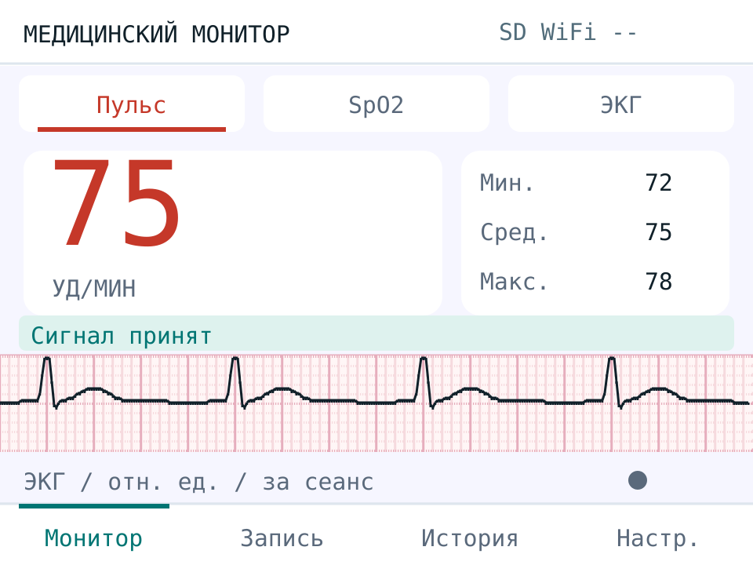
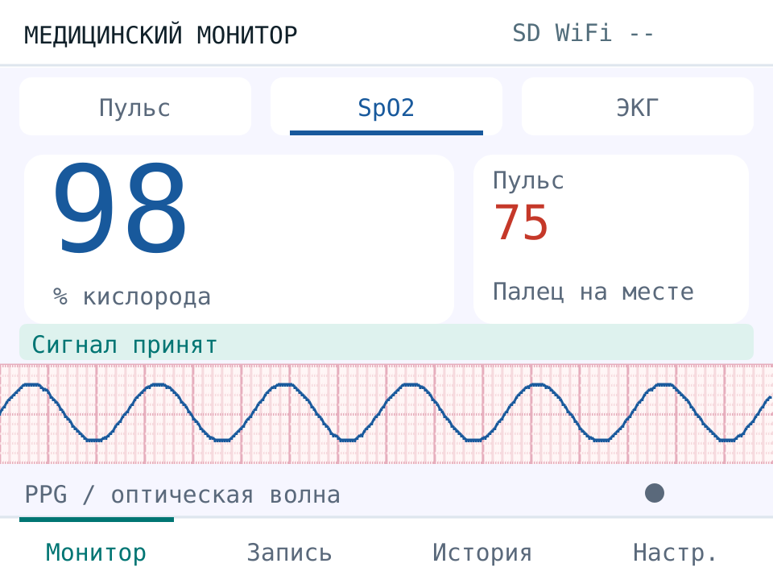

# Светлый интерфейс CardioMonitor

Все экраны прибора и Android-приложения используют светлую тему. Палитра:
фон `#F3F6F8`, текст `#14202B`, второстепенный текст `#5B6B78`, белые карточки,
бирюзовый акцент, пульс `#C0392B`, SpO₂ `#1A5A99`. На TFT цвета квантуются в RGB565.

## Прибор 320×240

Ниже **иллюстрации с синтетическими данными, не измерения человека**.
Их создаёт `tools/preview_display.py`, компилируя функции отрисовки из настоящего
скетча с адаптером SVG. Шрифты и строка состояния приблизительные; это не фотографии
дисплея и не проверка скорости SPI на плате.

| Пульс | SpO₂ |
|---|---|
|  |  |

| ЭКГ | Нет пригодного сигнала |
|---|---|
|  |  |

Кнопки на измерении: Монитор (следующая вкладка), Запись (вкл/выкл), История,
Настройки. В списках: Вверх, Вниз, OK, Назад. История и все служебные экраны
используют ту же светлую палитру.

Бумага розовая, линия ЭКГ чёрная. Амплитуда относительная, одно крупное деление
соответствует 0,2 с. Нельзя считать клетку физическим миллиметром или подписывать
10 мм/мВ без калибровки. Контакт электродов оценивается косвенно по сигналу:
LO+/LO− не подключены. Подсветка фиксирована подключением BLK к 3,3 В.

Чтобы обновить изображения из корня репозитория (Python 3, C++17, librsvg):

```sh
python3 'Monitor soft/tools/preview_display.py'
for name in pulse oxygen ecg no-signal; do
  rsvg-convert "Monitor soft/build/preview-light/$name.svg" \
    -o "Monitor soft/docs/light-interface/$name.png"
done
```

## Android

Главная / Записи / Устройство; белые скруглённые карточки, крупные показатели,
розовая бумага ЭКГ. Подробности записи открываются из истории: график с перемещением
по времени, статистика, экспорт CSV, подтверждаемое удаление только с телефона.
Тема остаётся светлой при тёмной системной теме.

Прошивка пока не передаёт данные приложению. Поэтому живые экраны показывают
прочерки и пустую сетку; кнопка синхронизации недоступна. Ни цифры, ни заряд,
ни состояние электродов не заменяются демонстрационными значениями.

Сборка APK и установка обновления на Samsung SM-S911B выполнены. Визуальная
проверка обновлённых экранов на телефоне требует разблокировки пользователем.
