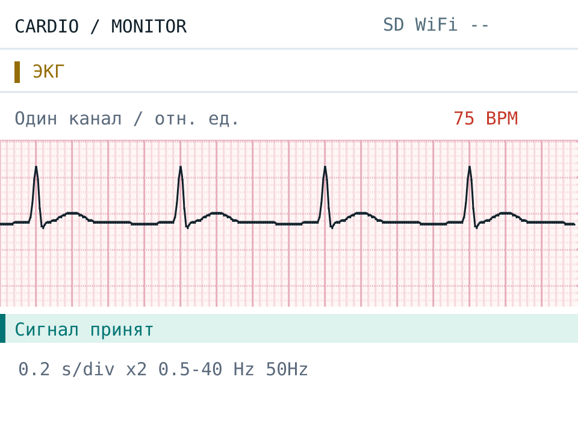

# Светлый интерфейс CardioMonitor

Все экраны прибора и Android-приложения используют светлую тему. Палитра:
фон приложения `#F3F6F8`, фон прибора белый, текст `#14202B`, второстепенный текст `#5B6B78`, белые карточки,
бирюзовый акцент, пульс `#C0392B`, SpO₂ `#1A5A99`. На TFT цвета квантуются в RGB565.

## Прибор 320×240

Прибор оформлен как компактная панель медицинского монитора: ровный белый фон,
тонкие разделители, заголовок выбранного измерения вместо ряда вкладок.
Восстановлено первоначальное главное меню с пятью пунктами. Основные цифры увеличены
с масштаба 5 до 6 и расположены по центру.
На отдельном экране ЭКГ остаётся график высотой 92 пикселя.
На экранах Пульс и SpO₂ нет графиков и спидометров. Пульс показывает крупное
значение ЧСС с подписью «уд/мин». SpO₂ показывает только процент кислорода,
без дополнительного пульса и подписи «уд/мин». Невалидные значения заменяются прочерками.
Состояние сигнала занимает одну полосу с цветовым маркером. История, настройки
и список Wi-Fi используют плоское выделение выбранной строки.

Ниже **иллюстрации с синтетическими данными, не измерения человека**.
Их создаёт `tools/preview_display.py`, компилируя функции отрисовки из настоящего
скетча с адаптером SVG. Шрифты и строка состояния приблизительные; это не фотографии
дисплея и не проверка скорости SPI на плате.

| Пульс | SpO₂ |
|---|---|
|  |  |

| ЭКГ | Нет пригодного сигнала |
|---|---|
|  |  |

Управление возвращено к первой схеме: **1 Вверх / 2 Вниз / 3 OK / 4 Назад**.
При включении — главное меню: ЭКГ, Пульс, SpO₂, История, Настройки.
Для смены раздела нажмите Назад, выберите его стрелками и нажмите OK.
Измерение завершается при выходе в меню; запись на SD использует сохранённый параметр
(по умолчанию включена).
Нижние подсказки управления убраны. Иконок нет: SD, Wi-Fi, заряд и запись
обозначены текстом. Параметры графика и сообщения о качестве сигнала сохранены.

Бумага розовая, линия ЭКГ чёрная. Амплитуда относительная, одно крупное деление
соответствует 0,2 с. Нельзя считать клетку физическим миллиметром или подписывать
10 мм/мВ без калибровки. Контакт электродов оценивается косвенно по сигналу:
LO+/LO− не подключены. Подсветка фиксирована подключением BLK к 3,3 В.

Чтобы обновить изображения из корня репозитория (Python 3, C++17, librsvg):

```sh
python3 'Monitor soft/tools/preview_display.py'
for name in pulse oxygen ecg no-signal; do
  rsvg-convert "Monitor soft/build/preview-light/$name.svg" \
    -o "Monitor soft/docs/light-interface/$name.png"
done
```

## Проверка и загрузка

10 октября 2026 года прошивка собрана для `esp32:esp32:makergo_c3_supermini`
и загружена через Arduino CLI на ESP32-C3 (4 МБ) по `/dev/ttyACM1`.
Загрузчик подтвердил контрольную сумму записанных данных и выполнил сброс платы.
Визуальные примеры выше проверены на компьютере; реальный дисплей дистанционно
не наблюдался.

## Android

Главная / Записи / Устройство; белые скруглённые карточки, крупные показатели,
розовая бумага ЭКГ. Подробности записи открываются из истории: график с перемещением
по времени, статистика, экспорт CSV, подтверждаемое удаление только с телефона.
Тема остаётся светлой при тёмной системной теме.

Прошивка пока не передаёт данные приложению. Поэтому живые экраны показывают
прочерки и пустую сетку; кнопка синхронизации недоступна. Ни цифры, ни заряд,
ни состояние электродов не заменяются демонстрационными значениями.

Сборка APK и установка обновления на Samsung SM-S911B выполнены. Визуальная
проверка обновлённых экранов на телефоне требует разблокировки пользователем.

## Обновление без постоянного стирания

Раньше поля измерений очищались пять раз в секунду даже при одинаковых значениях,
а диагностика каждую секунду очищала весь экран. Теперь текстовые поля имеют
фиксированный кэш: повторный вывод выполняется при изменении значения или входе
на экран. Стрелки в главном меню и категориях истории меняют только две строки.
В настройках обновляются изменившиеся строки; диагностика обновляет отдельные поля.

Крупные цифры собираются в `GFXcanvas16` 108×48 и отправляются готовым блоком:
10 368 байт RAM, один буфер на всё время работы. Полный framebuffer не создаётся.
При невозможности выделить буфер используется вывод цифр с непрозрачным фоном.
График по-прежнему обновляет столбцы; интервал обслуживания UI — 40 мс (до 25
обновлений в секунду, не измеренный FPS и не частота обновления самой матрицы).

Это уменьшает программное мерцание. Полное гашение подсветки или перезагрузки
платы нельзя объяснить только перерисовкой: при таком симптоме требуется проверка
питания, проводов и причины сброса. Работа реального дисплея дистанционно не наблюдалась.

## Настройки

Оставлены только Wi-Fi, Bluetooth и язык, без иконок и нижних подсказок.
Wi-Fi открывает поиск сетей; язык переключается кнопкой OK. Bluetooth показывает
«Не реализован»: транспорт Bluetooth/BLE ещё не добавлен. Параметры записи,
фильтрации и другие прежние настройки сохранены в NVS, но убраны из меню.

## Одно касание — одно действие

В истории, анализе, меню и настройках автоповтора нет.
Общий обработчик четырёх кнопок подтверждает нажатие за 20 мс, отпускание за 25 мс.
Удержание и короткий дребезг не открывают следующую вкладку; состояние обработчика
сохраняется при переходе между экранами. Потеря ADS1115 не переактивирует кнопку Назад.

На клавиатуре Wi-Fi только Вверх/Вниз имеют ускоряемый повтор: первое повторение
после 500 мс, затем интервалы 220 / 120 / 60 мс при удержании до 1,5 с / до 3 с /
дольше 3 с. Отпускание останавливает повтор сразу; OK и Назад остаются одиночными.
Удержанная до входа на клавиатуру кнопка не запускает повтор без нового касания.
