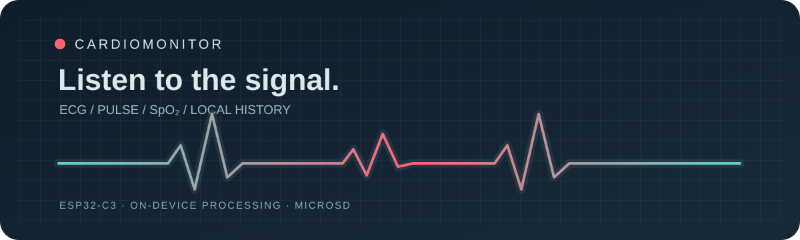

<p align="center">
  
</p>

<h1 align="center">CardioMonitor</h1>

<p align="center">
  An experimental device for viewing ECG, heart rate, and SpO₂.<br>
  Measure on the device · record to microSD · review history on Android
</p>

<p align="center">
  <code>ESP32-C3</code> · <code>AD8232</code> · <code>MAX30102</code> · <code>Arduino / C++</code> · <code>Kotlin / Compose</code>
</p>

---

CardioMonitor combines an analog ECG signal and optical RED/IR data in a device built around the **ESP32-C3 Super Mini**. It displays current readings on a color screen, saves sessions as CSV files on microSD, and reads history without loading an entire file into memory. The separate **HearT** Android app can view live readings and import recordings over a local Wi-Fi network.

> [!IMPORTANT]
> This is an experimental prototype, not a medical device. Its readings and history summaries have not been clinically validated and must not be used for diagnosis.

## From signal to recording

| Step | What happens |
|:--:|---|
| **01 · Capture** | The AD8232 sends the ECG signal through the ADS1115; the MAX30102 provides optical RED/IR samples. |
| **02 · Process** | The ESP32 filters ECG, draws the waveform, and estimates heart rate. An RF algorithm estimates pulse and SpO₂ when the optical signal is usable. |
| **03 · Display** | The 320 × 240 ILI9341 shows ECG, pulse, SpO₂, sensor status, and menus in English, Russian, or Kazakh. |
| **04 · Record** | Completed sessions are saved as CSV files on microSD. History is read in small chunks. |
| **05 · Review** | HearT receives live data and imports recordings over local Wi-Fi without a cloud service. |

## On-device screens

These previews come from the display drawing code with synthetic data. They show the interface, not measurements from a person.

| ECG | Pulse | SpO₂ |
|:---:|:---:|:---:|
|  |  |  |

The device menu contains **ECG → Pulse → SpO₂ → History → Settings**. Four touch buttons navigate, confirm, and go back. [Screen details and preview limitations](Monitor%20soft/docs/light-interface.md) (Russian).

## Hardware

| Component | Purpose |
|---|---|
| **ESP32-C3 Super Mini** | Acquires samples, processes signals, drives the display, stores settings, and handles local communication. |
| **AD8232 + ADS1115** | Analog ECG front end and digitization. |
| **MAX30102** | Optical data for pulse and preliminary SpO₂ estimates. |
| **2.4-inch ILI9341** | 320 × 240 color SPI display. |
| **microSD** | CSV measurement archive; the program itself runs from the ESP32's flash memory. |
| **4 × TTP223** | Touch controls for the device interface. |

**The engineering challenge:** a dedicated I²C task reads the sensors and passes samples through bounded queues. The main loop handles the display, SD recording, and communication. History analysis streams CSV data, so a recording does not need to fit entirely in RAM.

## Get started

**Firmware.** Open [MedicalMonitor.ino](Monitor%20soft/MedicalMonitor/MedicalMonitor.ino) in Arduino IDE with the entire `MedicalMonitor/` folder. Select **ESP32C3 Dev Module**, enable USB CDC on boot, use 4 MB flash, and select `No OTA (2MB APP/2MB SPIFFS)`. See the [firmware guide](Monitor%20soft/README.md) (Russian) for libraries, wiring, and upload steps.

**Android.** Open [CardioMonitorApp](CardioMonitorApp/README.md) in Android Studio and build the app. The device also works without it. The [Android guide](CardioMonitorApp/README.md) is currently in Russian.

**Run algorithm tests without hardware:**

```sh
python3 'Monitor soft/tests/run.py'
```

**Prepare and compile the firmware with Arduino CLI:**

```sh
python3 'Monitor soft/tools/build.py'
```

Compiling does not upload the firmware. Synthetic tests and a successful build do not replace checks with real sensors, the display, and an SD card.

## Repository map

```text
CardioMonitor/
├── Monitor soft/
│   ├── MedicalMonitor/     Arduino firmware: sensors, signals, display, SD, Wi-Fi
│   ├── tests/              native tests for algorithms and hardware models
│   ├── tools/              build script, signal plots, and display previews
│   └── docs/               wiring, interface, and analysis notes
├── CardioMonitorApp/       HearT Android client
├── docs/cardio-hero.svg    artwork for this page
└── .github/workflows/      automated firmware tests
```

More detail: [firmware file map](Monitor%20soft/README.md), [Android file map](CardioMonitorApp/README.md), [local communication protocol](Monitor%20soft/docs/local-link.md), and [history analysis notes](Monitor%20soft/docs/history-analysis-medical-notes.md). These detailed documents are currently in Russian.

## Prototype limitations

- The ECG graph shows a relative waveform; the firmware does not interpret ECG complexes for diagnosis. Its SpO₂ estimates have not been validated against a medical device.
- Code tests do not establish measurement accuracy or electrical safety. The analog circuit and power supply need separate hardware verification before measurements on a person.
- When electrodes touch a person, use standalone battery power. Do not connect USB, a charger, or non-isolated test equipment at the same time.
- The included RF algorithm has [its own author and license terms](Monitor%20soft/MedicalMonitor/Pulse%2BSpO2/MAX30102_by_RF-master/README.md); those terms do not automatically license the entire project.

<p align="center"><strong>From a signal at the input to a recording you can explore.</strong></p>
