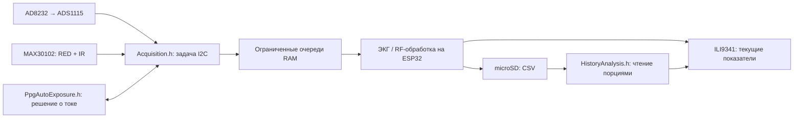

# CardioMonitor

Автономный монитор на **ESP32-C3 Super Mini**: цветной дисплей **2,4″ ILI9341 SPI,
320×240**, оптический датчик MAX30102, ЭКГ AD8232 через ADS1115, microSD и четыре
сенсорные кнопки TTP223. Android-приложение — отдельный незавершённый прототип.

ESP32 собирает и обрабатывает сигналы, рисует интерфейс и читает настройки.
**История хранится на SD-карте. SD не выполняет программу:** анализ истории
считает ESP32, читая файл небольшими порциями. Записи целиком в RAM не загружаются.

Это экспериментальная сборка. Проверки программы не подтверждают медицинскую
точность или электрическую безопасность устройства. Прошивка не ставит диагноз
и не исключает заболевания.

## Где искать подробности

| Документ | Содержание |
|---|---|
| [Главный README](README.md) | Карта репозитория, что куда загружать, быстрый старт, правила работы с файлами |
| [README прошивки](Monitor%20soft/README.md) | **Назначение каждого файла прошивки**, связи модулей, где менять функции, распиновка, алгоритмы, SD, сборка и проверка |
| [README Android](CardioMonitorApp/README.md) | **Назначение каждого Kotlin/config/resource-файла**, стек, протокол, экраны, БД и незавершённые части |
| [Обоснование анализа истории](Monitor%20soft/docs/history-analysis-medical-notes.md) | Источники рекомендаций, смысл порогов, ограничения выводов и необходимые проверки |
| [Происхождение RF-алгоритма](Monitor%20soft/Pulse%2BSpO2/MAX30102_by_RF-master/README.md) | Автор, лицензия, локальные изменения и оставшиеся файлы |

## Что реализовано

| Часть | Текущее состояние |
|---|---|
| Интерфейс | Светлые экраны ЭКГ, пульса, SpO₂, истории и настроек; RU/EN/KZ; четыре кнопки |
| ЭКГ | Сбор A0 ADS1115, фильтрация, график по времени и предварительная оценка частоты |
| Пульс / SpO₂ | RED/IR MAX30102, RF-алгоритм, проверки пригодности, сброс устаревших результатов |
| Автонастройка MAX30102 | Подбор токов RED/IR, ограничения, проверка регистров, новое окно после изменения |
| Одновременные датчики | В режиме ЭКГ доступны оптическая частота и SpO₂; частоты сравниваются отдельно |
| SD | CSV, страницы истории, сводка, анализ записанных оценок и справка о дальнейших действиях |
| Wi-Fi | Поиск, ввод пароля, сохранение сети, включение/выключение; сервера измерений пока нет |
| Android | Исходники клиента и экранов; готового соединения с этой прошивкой нет |
| Время записей | Порядковые номера и время от начала сессии; RTC/NTP пока нет |
| Медицинская диагностика | Нет диагностической расшифровки формы ЭКГ и подтверждённой точности SpO₂ |
| Железо | Сборка и модель I2C проверяют код; испытания конкретного устройства нужны отдельно |

Дробное уточнение оптической ЧСС, новый QRS-детектор, мастер записи на 30/60 секунд,
синхронизация времени и защищённая передача в приложение остаются будущими задачами.
Автонастройка уровня сигнала не является медицинской калибровкой.

## Структура проекта

```text
CardioMonitor/
├── README.md                         # Общая инструкция
├── .gitignore                        # Исключения для всего репозитория
├── .github/workflows/
│   └── firmware-tests.yml            # Нативные тесты в GitHub Actions
├── Monitor soft/
│   ├── README.md                     # Подробная карта файлов и инструкция устройства
│   ├── MedicalMonitor.ino            # setup/loop, экран, кнопки, Wi-Fi, SD, настройки
│   ├── Acquisition.h                 # Задача I2C, ADS1115/MAX30102, очереди
│   ├── SignalProcessing.h            # Окно пульса/SpO₂, пригодность, кнопки, батарея
│   ├── EcgProcessing.h               # Фильтры ЭКГ, частота, буфер графика
│   ├── PpgAutoExposure.h             # Автонастройка оптических уровней
│   ├── HistoryAnalysis.h             # Потоковый CSV-анализ и накопители статистики
│   ├── HistoryText.h                 # Объяснения и советы для истории EN/RU/KZ
│   ├── rf_algorithm.cpp              # Включение RF-реализации в сборку Arduino
│   ├── Pulse+SpO2/MAX30102_by_RF-master/
│   │   ├── README.md                 # Происхождение и роль сохранённого алгоритма
│   │   ├── algorithm_by_RF.cpp        # Расчёт оптической ЧСС и SpO₂
│   │   └── algorithm_by_RF.h          # API, частота, окно и пороги RF
│   ├── tools/
│   │   ├── build.py                   # Подготовка скетча, сборка, явная загрузка
│   │   └── plot_ecg.py                # График CSV или синтетический пример фильтра
│   ├── tests/
│   │   ├── run.py                    # Запуск C++ тестов с ASan/UBSan
│   │   ├── signal_tests.cpp           # Пульс/SpO₂, сбросы, кнопки, батарея
│   │   ├── acquisition_tests.cpp      # Настоящий цикл сбора на модели I2C
│   │   ├── ecg_tests.cpp              # Фильтры, шум, временная шкала, ЧСС
│   │   ├── history_analysis_tests.cpp # CSV, качество, эпизоды, повреждения
│   │   └── ppg_auto_tests.cpp         # Токи LED, границы, выдержки, нестабильность
│   └── docs/
│       ├── ecg-filter-demo.png        # Синтетическая иллюстрация фильтра
│       └── history-analysis-medical-notes.md
└── CardioMonitorApp/
    ├── README.md                     # Карта всех файлов приложения и ограничения
    ├── build.gradle.kts              # Плагины проекта
    ├── settings.gradle.kts           # Модули и репозитории
    ├── gradle.properties             # Параметры Gradle/Kotlin/Compose
    ├── gradlew / gradlew.bat          # Запуск Gradle на Unix/Windows
    ├── gradle/wrapper/               # JAR загрузчика и закреплённая версия Gradle
    └── app/
        ├── build.gradle.kts          # SDK, сборка приложения, зависимости
        └── src/main/
            ├── AndroidManifest.xml  # Application/Activity и разрешения
            ├── res/values/          # strings.xml и themes.xml
            └── java/com/cardiomonitor/app/
                ├── CardioMonitorApp.kt          # Создание БД, сети и репозитория
                ├── MainActivity.kt              # Вход в Compose
                ├── domain/model/Models.kt       # Модели сессий и измерений
                ├── data/local/Entities.kt       # Таблицы Room
                ├── data/local/AnalysisDao.kt    # Запросы к таблицам
                ├── data/local/AppDatabase.kt    # Room/SQLCipher
                ├── data/network/DeviceConnectionManager.kt # TLS-клиент и пакеты
                ├── data/repository/AnalysisRepository.kt   # Сеть → сессии → БД
                ├── ui/navigation/AppNavigation.kt         # Маршруты экранов
                ├── ui/live/LiveMonitorViewModel.kt         # Состояние live-экрана
                ├── ui/live/LiveMonitorScreen.kt            # Показания и график
                ├── ui/history/HistoryScreen.kt            # Список сессий
                └── ui/detail/SessionDetailScreen.kt       # Незавершённый экран записи
```

## Как движутся данные



Задача датчиков не рисует экран и не пишет SD. Основной цикл не обращается к I2C
напрямую после запуска задачи. Решение о токе принимает чистый C++ модуль,
а регистры меняет `Acquisition.h`. В NVS лежат только небольшие настройки,
например язык, Wi-Fi и переключатель автонастройки.

## Что куда загружать

| Куда | Что требуется |
|---|---|
| ESP32-C3 | Одна прошивка: `.ino` и подключённые `.h/.cpp` компилируются вместе и загружаются через USB |
| microSD | Пустая карта FAT32; CSV создаёт сама прошивка. Исходники, библиотеки и APK на карту не копируются |
| Телефон | Отдельное приложение после его доработки и сборки; для автономного монитора оно не требуется |

Внутренняя flash ESP32 хранит программу и NVS. История не копируется во внутреннюю
файловую систему. Без SD текущие измерения работают, запись и история недоступны.

## Быстрый старт с прошивкой

Команды выполняются **из корня репозитория**. Кавычки нужны из-за пробела в
`Monitor soft`. Нужны Python 3, для тестов — C++17-компилятор `c++` с ASan/UBSan,
для сборки платы — Arduino CLI с ESP32 core и библиотеками из
[инструкции прошивки](Monitor%20soft/README.md#сборка-и-загрузка).

```sh
# Проверить алгоритмы и модель оборудования без платы
python3 'Monitor soft/tests/run.py'

# Подготовить папку Arduino IDE, не компилируя прошивку
python3 'Monitor soft/tools/build.py' --stage-only

# Подготовить и скомпилировать ESP32-C3, без загрузки на плату
python3 'Monitor soft/tools/build.py'

# Скомпилировать и загрузить в явно выбранный порт
python3 'Monitor soft/tools/build.py' --upload /dev/ttyACM0
```

Порт `/dev/ttyACM0` — пример. Для Arduino IDE открывайте
**`Monitor soft/build/MedicalMonitor/MedicalMonitor.ino`**, сохраняя рядом все
подготовленные `.h/.cpp` и вложенную папку RF. Плата: ESP32C3 Dev Module,
USB CDC при запуске, 4 МБ flash, Default partitions.

**Редактируйте исходники в `Monitor soft/`, а не копии в `build/MedicalMonitor/`.**
Повторный запуск `build.py` перезаписывает подготовленные исходники. Поэтому файл
из `build`, открытый сейчас в IDE, не является главным файлом для изменений в Git.
После добавления нового заголовка включите его в явный список `tools/build.py`.
Распиновка, управление и проверки на устройстве — в [README прошивки](Monitor%20soft/README.md).

## Локальные и сгенерированные файлы

| Путь | Назначение и обращение |
|---|---|
| `Monitor soft/build/MedicalMonitor/` | Подготовленный скетч; восстанавливается через `--stage-only` |
| `Monitor soft/build/objects/` | Объектные файлы Arduino CLI; следующая сборка создаёт их заново |
| `Monitor soft/build/firmware/` | Скомпилированные `.bin/.elf/.map`; пересоздаются через `build.py` |
| `Monitor soft/build/MedicalMonitor/build/` | Возможные экспорты Arduino IDE; не исходники |
| `Monitor soft/build/preview/cardio-display.html` | Если есть локально: ранний макет с вымышленными показаниями, не актуальная прошивка; не нужен для сборки |
| `CardioMonitorApp/app/build/`, `build/`, `.gradle/` | Результаты и кэш Android-сборки |
| `CardioMonitorApp/local.properties` | Локальный путь Android SDK; не публикуется, сохраняется на рабочем компьютере |
| `.idea/`, `.kotlin/`, `.github/modernize/` | Локальное состояние IDE/инструментов, не код прибора |
| `.agents/`, `.codex/` | Служебное окружение инструментов; не включается в Git |
| `.git/` | История и настройки репозитория; это не кэш, удалять при очистке нельзя |
| `*.csv`, `measurements/` | Личные записи; по умолчанию исключены из Git |
| `.env*`, `*.jks`, `*.keystore`, `key.properties` | Локальные секреты и ключи; не включаются в репозиторий |

**`gradle-wrapper.jar` сохраняется**: это часть запуска закреплённого Gradle,
а не скомпилированное приложение. Заголовки `.h` тоже обязательные исходники.

При очистке удалены Java heap dump, результаты сборок и кэш Gradle проекта;
сохранены настройки IDE/SDK, подготовленный Arduino-скетч и локальный ранний макет.
Из старого MAX30102-примера удалены самостоятельный скетч, неиспользуемые драйверы,
альтернативный алгоритм и демонстрационные CSV/PNG. Рабочий RF-код и лицензии
сохранены. Общие исключения задаёт один корневой `.gitignore`.

## Что подтверждают проверки

`tests/run.py` запускает пять групп: сигналы, сбор данных, ЭКГ, история,
автонастройка. Используются ASan/UBSan; LeakSanitizer отключён для совместимости
с ограниченным окружением. Workflow `.github/workflows/firmware-tests.yml`
запускает эти тесты при push/PR. Он не прошивает плату, не выполняет клиническую
проверку, не собирает Android и не заменяет компиляцию ESP32 через Arduino CLI.

После очистки зависимости проверяются тестами и сборкой ESP32-C3. На используемой
конфигурации прошивка занимает около 1,16 МБ (88% раздела), статические данные —
около 46 КБ. Это не полный пиковый расход RAM: дополнительно нужны очереди,
стек, Wi-Fi, SD и небольшие строки.

При контакте электродов с человеком используйте автономное батарейное питание
без одновременно подключённых USB, сетевого зарядника или неизолированных приборов.
Проверку аналогового тракта начинайте с подходящего изолированного стенда/симулятора.

## Происхождение кода

RF-реализация основана на работе **Robert Fraczkiewicz**. Авторские уведомления
и условия использования находятся в обоих `algorithm_by_RF.*` и сохраняются
при распространении. Их лицензия не является автоматически лицензией всего проекта.
Внешние Arduino/Android-библиотеки устанавливаются менеджерами зависимостей;
их исходники и глобальные кэши здесь не дублируются.
